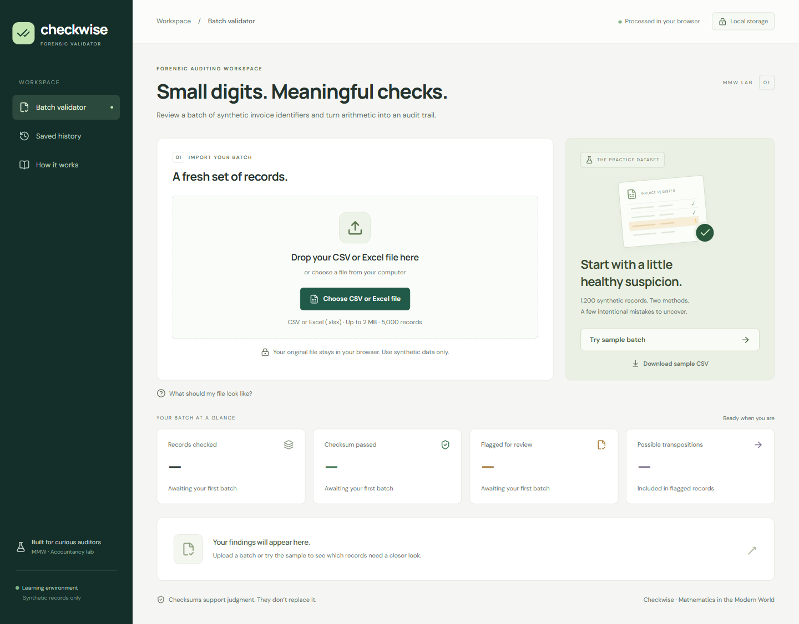

<div align="center">
  <h1>Checkwise</h1>
  <p><strong>Small digits. Meaningful checks.</strong></p>
  <p>Forensic Check-Digit Validator · Mathematics in the Modern World</p>
</div>



## About the project

Checkwise is a browser-based forensic check-digit validator designed for *Mathematics in the Modern World* and accountancy laboratories. It turns modular arithmetic into an interactive audit trail—helping students and auditors validate batches of synthetic invoice and supplier identifiers, catch data-entry mistakes, and inspect likely digit transpositions before records enter a ledger.

All spreadsheet parsing and checksum verification run locally inside a dedicated Web Worker, with optional batch history stored in the browser via IndexedDB. No accounts, backend services, external databases, or environment variables are required.

## Key capabilities

- **Batch spreadsheet validation** — Upload `.csv` or Excel (`.xlsx`) batches up to 2 MB and 5,000 records, or launch the built-in 1,200-record synthetic dataset with one click.
- **Dual check-digit schemes** — Verify identifiers against both the Luhn (modulo 10) algorithm and an instructional modulo-11 weighting scheme.
- **Transposition detection** — Automatically test adjacent digit swaps on failed records to surface possible typing transpositions alongside exact character positions.
- **Exception review & safe export** — Search and filter flagged records by finding category (`invalid_format`, `checksum_failed`, `possible_transposition`) and export formula-escaped CSV exception reports.
- **Local history & privacy** — Persist run summaries and flagged exceptions in IndexedDB for later review without ever transmitting source files over the network.

## Built with

<table align="center">
  <thead>
    <tr>
      <th align="center">Layer</th>
      <th align="center">Technologies</th>
    </tr>
  </thead>
  <tbody>
    <tr><td align="center">Frontend</td><td align="center">React 19 · TypeScript · Vite · Lucide Icons</td></tr>
    <tr><td align="center">Parsing &amp; compute</td><td align="center">Web Workers · Papa Parse · read-excel-file</td></tr>
    <tr><td align="center">Local persistence</td><td align="center">IndexedDB</td></tr>
    <tr><td align="center">Quality &amp; testing</td><td align="center">Vitest · fake-indexeddb</td></tr>
  </tbody>
</table>

## Sample datasets & input format

Ready-to-test sample files are available in [`sample-data/`](sample-data/):

- **[checkwise-sample-1200.csv](sample-data/checkwise-sample-1200.csv)** & **[checkwise-sample-1200.xlsx](sample-data/checkwise-sample-1200.xlsx)** — 1,200 deterministic synthetic records (900 passing, 300 flagged, including 224 possible adjacent transpositions).
- **[checkwise-sample-quick.xlsx](sample-data/checkwise-sample-quick.xlsx)** — A compact 15-record Excel sheet for quick inspection.

Input files must use these three columns in exact order:

```csv
invoice_id,identifier_type,identifier_value
DEMO-001,luhn,79927398713
DEMO-002,mod11,1236
DEMO-003,mod11,6X
```

- **Format rules:** Identifiers are evaluated as strings including their final check digit (keep cells formatted as text to preserve leading zeros). Allowed `identifier_type` values are `luhn` (2–32 digits) and `mod11` (1–31 payload digits plus a final digit or uppercase `X`).
- **Batch limits:** Up to 2 MB and 5,000 records per file. Field lengths are capped at 80 characters (`invoice_id`), 32 (`identifier_type`), and 128 (`identifier_value`). Structural file errors reject the batch; row-level format or checksum issues are reported as findings.

## Mathematics & audit scope

- **Luhn (Modulo 10):** Starting from the rightmost payload digit, double every second digit and subtract 9 from any product greater than 9. The check digit is `(10 - sum % 10) % 10`.
- **Instructional Mod-11:** Multiply payload digits from right to left by cycling weights `2, 3, 4, 5, 6, 7`. The check digit is `(11 - sum % 11) % 11`, where `10` is represented as `X`. *(Note: This is a demonstration classroom scheme, not an official TIN or SSS rule.)*
- **Possible transpositions:** When a well-formed identifier fails its checksum, Checkwise tests swapping each adjacent pair of distinct numeric digits. Passing swaps are reported as possibilities to check against source documents, never as automatic corrections.
- **Audit & privacy limits:** A passing checksum confirms mathematical consistency only—not the authenticity of an invoice, supplier identity, or absence of fraud. Saved runs keep only summary counts and flagged rows in the local browser profile and are not tamper-proof audit evidence.
